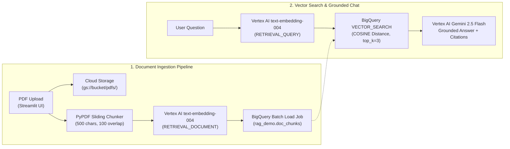

# 🔍 Enterprise GCP RAG Demo — Cloud Storage, Vertex AI & BigQuery Vector Search


An enterprise-grade **Retrieval-Augmented Generation (RAG)** web application built on **Google Cloud**. It demonstrates an end-to-end unstructured document pipeline: uploading PDFs to **Google Cloud Storage (GCS)**, chunking text with sliding overlap, generating 768-dimensional vectors with **Vertex AI (`text-embedding-004`)**, indexing into **BigQuery**, and executing native SQL `VECTOR_SEARCH` queries grounded with **Gemini (`gemini-2.5-flash`)**.

---

## 📐 Architecture



---

## ✨ Key Features

- **Automated GCP Infrastructure Provisioning**: Automatically verifies and creates the target GCS Bucket, BigQuery Dataset (`rag_demo`), and Vector Table (`doc_chunks` with `ARRAY<FLOAT64>` embeddings) on startup.
- **Zero-Buffer BigQuery Load Jobs**: Uses `load_table_from_file` with newline-delimited JSON (`NDJSON`) rather than streaming inserts so ingested vectors are immediately queryable via `VECTOR_SEARCH`.
- **Task-Specific Asymmetric Embeddings**: Uses `RETRIEVAL_DOCUMENT` during corpus indexing and `RETRIEVAL_QUERY` at search time to maximize retrieval precision.
- **Transparent Pipeline Telemetry**: Displays live chunk previews, 768-dimensional vector previews, target SQL statements, and source similarity scores (`1 - distance`).

---

## 🛠️ Tech Stack

| Component | Service / Library | Purpose |
| :--- | :--- | :--- |
| **UI Framework** | Streamlit | Two-tab ingestion & conversational interface |
| **Object Storage** | Google Cloud Storage (`google-cloud-storage`) | Durable archival storage for raw uploaded PDFs |
| **Embedding Model** | Vertex AI `text-embedding-004` | 768-dimensional semantic vector generation |
| **Vector Database** | Google Cloud BigQuery (`VECTOR_SEARCH`) | Serverless SQL vector storage and cosine similarity search |
| **Generative LLM** | Vertex AI `gemini-2.5-flash` | Context-grounded question answering |
| **PDF Parser** | `pypdf` | Page-level text extraction |

---

## 📁 Project Structure

```text
bigquery-vector-search-rag/
├── main.py                  # Primary application entry point
├── app.py                   # Streamlit runner alias
├── feature_rag_pipeline.py  # GCP provisioning, PDF chunking, BigQuery load, and UI logic
├── .env.example             # Environment variable template
├── requirements.txt         # Python dependencies
└── README.md                # Project documentation
```

---

## ⚙️ Environment Variables

| Variable | Required | Default | Description |
| :--- | :---: | :---: | :--- |
| `GCP_PROJECT_ID` | Yes | — | Google Cloud Project ID |
| `GCP_LOCATION` | No | `us-central1` | Vertex AI region |
| `GCS_BUCKET_NAME` | Yes | `<GCP_PROJECT_ID>-rag-docs` | Cloud Storage bucket for uploaded PDFs |
| `BQ_DATASET` | No | `rag_demo` | BigQuery dataset name |
| `BQ_TABLE` | No | `doc_chunks` | BigQuery table name for document chunks and embeddings |
| `CHUNK_SIZE` | No | `500` | Character window per text chunk |
| `CHUNK_OVERLAP` | No | `100` | Character overlap between consecutive chunks |

---

## 🚀 Quickstart

### 1. Install Dependencies

```bash
git clone https://github.com/shubhamv3129/bigquery-vector-search-rag.git
   cd bigquery-vector-search-rag
python3 -m venv .venv
source .venv/bin/activate
pip install -r requirements.txt
```

### 2. Configure GCP Environment

```bash
cp .env.example .env
# Edit .env with your GCP_PROJECT_ID and GCS_BUCKET_NAME

gcloud auth application-default login
gcloud services enable storage.googleapis.com aiplatform.googleapis.com bigquery.googleapis.com
```

### 3. Run the Application

```bash
streamlit run main.py
```

Open `http://localhost:8501` in your browser.
